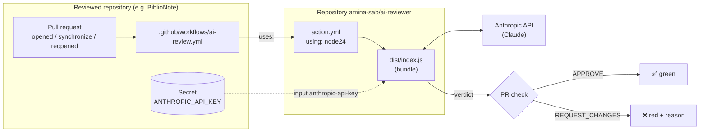
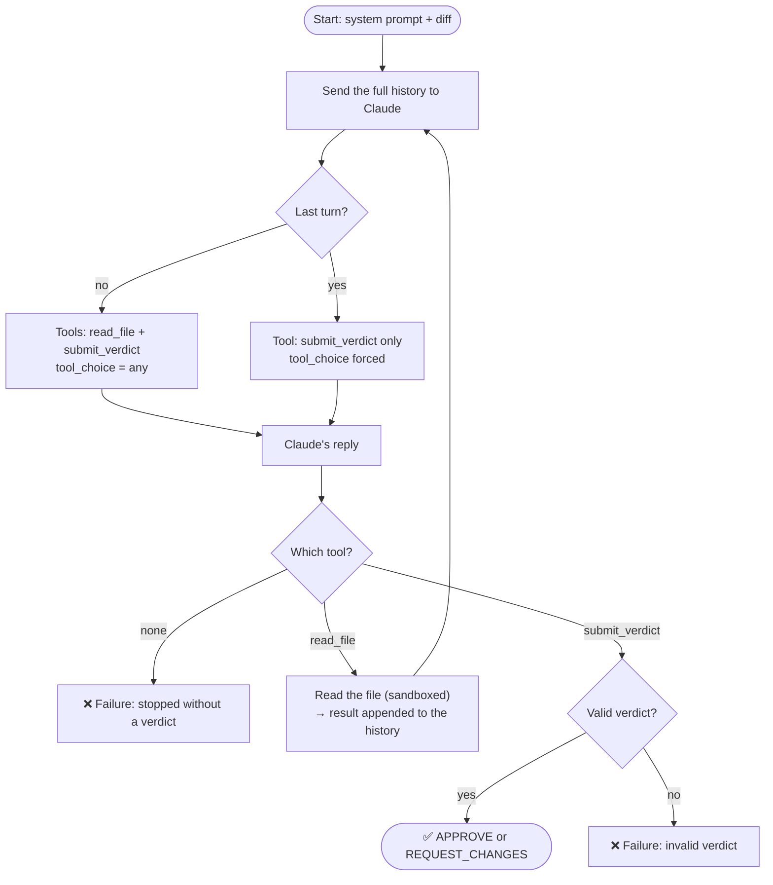
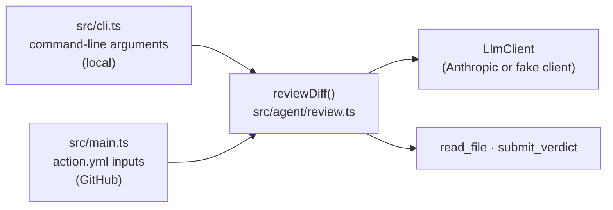

# AI Reviewer

> A GitHub Action that has an AI agent (Claude) review every pull request and return a clear verdict: **`APPROVE`** or **`REQUEST_CHANGES`**, with the reason.

The agent does not just read the diff: when it lacks context (a caller, a class in use, an exception type), it **reads the repository files itself** before deciding. The verdict becomes a check on the PR: green if the agent approves, red if it requests changes.

```text
PR opened ──► AI Reviewer ──► ✅ APPROVE           → green check
                          └─► ❌ REQUEST_CHANGES   → red check + reason
```

---

## What it does

| | |
| --- | --- |
| **Input** | The diff of a pull request |
| **Agent tools** | `read_file` (read a file from the repository) · `submit_verdict` (return the decision) |
| **Output** | `APPROVE` or `REQUEST_CHANGES` + a reason that names the file at fault |
| **Effect on the PR** | Green or red check, verdict and reason in the job logs |
| **Language** | TypeScript, `node24` JavaScript action |
| **Default model** | `claude-haiku-5-5` (configurable) |

The agent blocks a PR when the diff:

- introduces a **bug** (exception, wrong result);
- **breaks a caller** (signature change not propagated);
- creates a **security flaw** (SQL injection, sensitive data exposed, secret in plain text).

---

## How it works
### Overview


### The agent loop

The core of the tool is an **agentic loop**: the model proposes an action, the code runs it and sends back the result, until the model concludes.



Three design rules:

1. **The model proposes, the code decides.** Claude asks for reads and proposes a verdict; the code executes, validates and decides the effect on the PR.
2. **A verdict is guaranteed.** On the last turn, the code only offers `submit_verdict` and forces it: the agent cannot loop forever without concluding.
3. **The model is stateless.** On every turn, the whole history (diff, requests, files read) is sent again. That is why input tokens grow with each turn.

---

## Quick start

Estimated time: 10 minutes.

### 1. Add the API key to the reviewed repository

In the repository that will receive reviews: **Settings → Secrets and variables → Actions → New repository secret**

| Field | Value |
| --- | --- |
| Name | `ANTHROPIC_API_KEY` |
| Secret | your Anthropic API key (`sk-ant-…`) |

> Keys are created in the Claude Console (**API Keys**). A claude.ai subscription does not include API access.

### 2. Create the workflow

In the reviewed repository, create `.github/workflows/ai-review.yml`:

```yaml
name: AI Reviewer

on:
  pull_request:
    types: [opened, synchronize, reopened]

permissions:
  contents: read

jobs:
  review:
    runs-on: ubuntu-latest
    steps:
      - uses: actions/checkout@v5
        with:
          fetch-depth: 0          # full history, to compare with the base branch

      - name: Compute the PR diff
        run: git diff --output=pr.diff origin/${{ github.base_ref }}...HEAD

      - name: Agent review
        uses: amina-sab/ai-reviewer@main
        with:
          anthropic-api-key: ${{ secrets.ANTHROPIC_API_KEY }}
          diff-path: pr.diff
```

### 3. Open a pull request

The **AI Reviewer / review** check appears at the bottom of the PR. Click **Details** to see the agent's reasoning:

```text
[tour 1] stop=tool_use outils=read_file tokens_in=2807
  read_file {"path":"src/BiblioNote.Presentation/Program.cs"} → ok
[tour 2] stop=tool_use outils=submit_verdict tokens_in=3696
Verdict : REQUEST_CHANGES
Raison  : BiblioNoteExceptionHandler is never registered in Program.cs…
```

> **Testing without touching `main`**: put the workflow in a test branch together with some code to review, then open a PR. GitHub runs the workflow contained in the PR itself. Merge it into `main` only once you are satisfied: every following PR will then be reviewed.

---

## Developing the tool

### Prerequisites

- Node.js 24
- An Anthropic API key in a `.env` file at the root (never committed):

```dotenv
ANTHROPIC_API_KEY=sk-ant-...
```

No quotes, no semicolon.

### Installation

```powershell
git clone https://github.com/amina-sab/ai-reviewer.git
cd ai-reviewer
npm install
```

### Commands

| Command | Purpose |
| --- | --- |
| `npm run review -- <file.diff> [repo-root]` | Reviews a diff locally (entry point `src/cli.ts`). Exit code 0 = APPROVE, 1 = REQUEST_CHANGES, 2 = error. |
| `npm run eval -- <repo-root> [model]` | Runs the agent on the whole corpus and measures its agreement with the expected verdicts. |
| `npm run typecheck` | Type-checks the code (`tsc --noEmit`). |
| `npm test` | Vitest unit tests with a fake LLM client (no API calls, free). |
| `npm run build` | Builds `dist/index.js` with esbuild. |

### Two entry points, one agent



`review.ts` knows nothing about the command line or GitHub: it receives a diff and a client, and returns a verdict. That is what makes it testable with a fake client and pluggable into two different entry points.

### Simulating GitHub locally

On GitHub, the `anthropic-api-key` input arrives in the `INPUT_ANTHROPIC-API-KEY` environment variable. You can create it yourself (PowerShell):

```powershell
${env:INPUT_ANTHROPIC-API-KEY} = ((Get-Content .env | Select-String "^ANTHROPIC_API_KEY=").Line -split "=", 2)[1].Trim().Trim('"', "'", ';')
${env:INPUT_DIFF-PATH} = "tests/diffs/sql-concat.diff"
$env:GITHUB_WORKSPACE = "C:\path\to\the\reviewed\repository"
npm run build
node dist/index.js
$LASTEXITCODE        # 1 for REQUEST_CHANGES, 0 for APPROVE
```

The verdict must be the same as with `npm run review`.

---

## Project structure

```text
ai-reviewer/
├── action.yml                 ← action identity card (inputs, outputs, node24)
├── package.json               ← dependencies and scripts
├── tsconfig.json              ← strict TypeScript
├── .env                       ← local API key (ignored by Git)
├── dist/
│   └── index.js               ← generated and committed bundle: run by GitHub
├── src/
│   ├── cli.ts                 ← local entry point
│   ├── main.ts                ← GitHub entry point
│   ├── agent/
│   │   ├── review.ts          ← the agentic loop
│   │   ├── llmClient.ts       ← LlmClient interface + Anthropic client
│   │   ├── verdict.ts         ← Verdict type and validation
│   │   └── prompts/
│   │       └── system.ts      ← versioned system prompt (PROMPT_VERSION)
│   └─── tools/
│       ├── readFile.ts        ← safe read, confined to the repository
│       └── submitVerdict.ts   ← terminal tool and its schema
│   
├── tests/
│   ├── unit/                  ← Vitest tests (fake client)
│   ├── diffs/                 ← evaluation corpus
│   └── expected.json          ← expected verdicts
└── .github/workflows/
    └── ci.yml                 ← typecheck + tests + dist/ check
```

